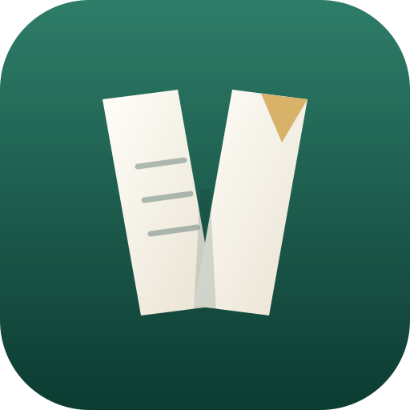
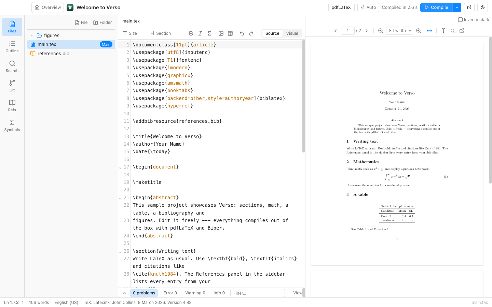

<p align="center">
  
</p>

<h1 align="center">Verso</h1>

<p align="center">
  A local, offline-first LaTeX editor for macOS, Windows and Linux.<br>
</p>

<p align="center">
  <a href="LICENSE"></a>
  
  
</p>

<picture>
  <source media="(prefers-color-scheme: dark)" srcset="docs/screenshots/main-dark.png">
  
</picture>

Verso compiles with the TeX installation you already have (TeX Live, MacTeX, MiKTeX). There
are no accounts and no cloud: your project is a folder, collaboration happens through Git,
and every change is kept in a local version history.

## Highlights

- **Write → compile → read in one window.** latexmk with pdfLaTeX, XeLaTeX or LuaLaTeX,
  optional auto-compile, readable error explanations and SyncTeX in both directions.
- **An editor that knows LaTeX.** Autocomplete for commands, environments, labels,
  citations and files; snippets, folding, outline, spellcheck (English/German), Vim mode.
- **Visual mode.** Headings, formatting, lists, math, figures, tables and citations
  rendered in place, while the source stays clean LaTeX.
- **Bibliography tools.** Add entries by DOI, arXiv id or ISBN, cite picker, duplicate and
  unused-entry reports.
- **Never lose work.** Autosave, crash recovery and snapshot history with diffs and
  restore — independent of Git.
- **Git built in.** Stage, commit, push, pull, switch and create branches, inspect
  commits.
- **Optional AI chat** with a local Ollama model or a cloud provider of your choice.

## Install

Download the installer for your system from the
[latest release](../../releases/latest):

| System  | File                             |
| ------- | -------------------------------- |
| macOS   | `.dmg` (Apple Silicon and Intel) |
| Windows | `.exe` installer                 |
| Linux   | `.AppImage` or `.deb`            |

The installers are not code-signed yet, so your system will warn you on first launch:

- **macOS** reports that Verso "is damaged" or "cannot be verified". Move Verso to
  Applications, then run `xattr -cr /Applications/Verso.app` in Terminal once.
- **Windows** SmartScreen shows "Windows protected your PC": click **More info → Run
  anyway**.

You also need a TeX distribution with `latexmk`:
[MacTeX](https://www.tug.org/mactex/) on macOS, [TeX Live](https://tug.org/texlive/) on
Linux, [MiKTeX](https://miktex.org) or TeX Live on Windows (plus Perl for `latexmk`).

## Quick start

1. Start Verso — the welcome sheet checks your TeX installation.
2. Click **Open sample project**, or **New Project** to start from a template, or
   **Open Folder…** to use an existing LaTeX folder.
3. Press `Cmd/Ctrl + Enter` to compile. Click into the PDF to jump to the source,
   press `Cmd/Ctrl + Alt + →` to jump from the source to the PDF.

`Cmd/Ctrl + Shift + P` opens the command palette with every command and its shortcut.

## Documentation

- [Getting started](docs/getting-started.md) — the everyday workflow in detail
- [Keyboard shortcuts](docs/keyboard-shortcuts.md)
- [Troubleshooting](docs/troubleshooting.md) — TeX not found, Biber, compile problems
- [Editor themes](docs/themes.md)
- [All documentation](docs/README.md), including architecture and development guides

## Build from source

```bash
npm install
npm run dev      # run the app in development mode
npm test         # unit tests
npm run dist     # build an installer for the current OS
```

Requires Node.js 22+. See [Development](docs/development.md) for all scripts and the test
setup.

## Contributing

Bug reports, ideas and pull requests are welcome — please read
[CONTRIBUTING.md](CONTRIBUTING.md) first. Security issues: see [SECURITY.md](SECURITY.md).

## Use of AI

Verso was developed with the help of AI coding assistants, including Claude Code.

## License

[MIT](LICENSE)

The spellcheck dictionaries are third-party and are bundled unmodified, each with its
license: English (SCOWL/Hunspell, MIT and BSD) and German (igerman98 by Björn Jacke,
GPL-2.0 or GPL-3.0). They are installed from the npm packages
[`dictionary-en`](https://github.com/wooorm/dictionaries/tree/main/dictionaries/en) and
[`dictionary-de`](https://github.com/wooorm/dictionaries/tree/main/dictionaries/de),
where their sources are available.
