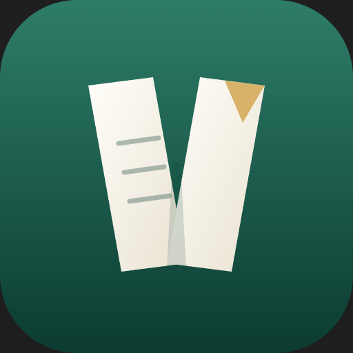

<p align="center">
  
</p>

<h1 align="center">Verso for macOS</h1>

<p align="center">
  A native, local, offline-first LaTeX editor for macOS — built with SwiftUI, AppKit and PDFKit.<br>
</p>

<p align="center">
  <a href="LICENSE"></a>
  
  
  
</p>

Verso for macOS is a native rewrite of [Verso](https://github.com/LeoB914/verso) by Leonard
Becker, which is a cross-platform Electron app. This fork contains only the native version.
It has no web view and no Node runtime, and it uses the system's text system, PDFKit and
FSEvents.

Verso compiles with the TeX installation you already have (MacTeX or TeX Live). There are
no accounts and no cloud. Your project is a folder, collaboration happens through Git, and
every change is kept in a local version history.

## Highlights

- **Write → compile → read in one window.** latexmk with pdfLaTeX, XeLaTeX or LuaLaTeX,
  optional auto-compile, a problems panel with readable error explanations, and SyncTeX
  in both directions.
- **An editor that knows LaTeX.** Syntax highlighting, line numbers with error markers,
  and autocompletion for commands, environments, labels, citations, packages, files and
  your own macros. It also has snippets with tab stops, `\begin{…}` → `\end{…}`, `\item`
  continuation and bracket/`$` pairing.
- **Project tools.** File tree with drag & drop, an outline that follows
  `\input`/`\include`, project-wide search and replace, a symbol palette, a table dialog
  and a word count (texcount).
- **Bibliography tools.** Add entries by DOI, arXiv id or ISBN. The app also has a cite
  picker and a report of missing, unused and duplicate entries.
- **Never lose work.** Autosave and snapshot history with diffs and restore, independent
  of Git.
- **Git built in.** Stage, commit, push, pull, switch and create branches, and inspect
  commits.
- **Native macOS.** Menu bar commands with keyboard shortcuts, a command palette, the
  system find bar and spell checker, and light and dark mode.

## Requirements

- macOS 15 or later
- A TeX distribution with `latexmk`, e.g. [MacTeX](https://www.tug.org/mactex/)
- Optional: `git` (Xcode command line tools) for the Git panel
- To build: Xcode 16 or later

## Download

Download **Verso-macOS.zip** from the [latest release](https://github.com/schneider-leon/verso/releases/latest)
(universal build for Apple Silicon and Intel). Unzip it and move **Verso.app** to *Applications*.

The app is not notarized by Apple, so macOS blocks the first launch with "Apple could not
verify…". To allow it, do one of the following:

- Open *System Settings → Privacy & Security*, scroll down and click **Open Anyway**, or
- run this once in Terminal:

  ```bash
  xattr -dr com.apple.quarantine /Applications/Verso.app
  ```

## Build from source

```bash
git clone https://github.com/schneider-leon/verso.git
open verso/verso-macOS.xcodeproj
```

In Xcode, select your own team under *Signing & Capabilities* (or "Sign to Run Locally").
Then run the **verso-macOS** scheme (⌘R). The built app is called `Verso.app`.

The App Sandbox is disabled on purpose: `latexmk` and TeX need the login-shell `PATH`,
`~/Library/texlive` and arbitrary project folders.

## Quick start

1. Start Verso. The welcome sheet checks your TeX installation.
2. Click **Open Sample Project**, **New Project** to start from a template, or
   **Open Folder…** to use an existing LaTeX folder. You can also import a ZIP, e.g. from
   Overleaf.
3. Press `⌘↩` to compile. Press `⌥⌘→` to jump from the source to the PDF; `⌘`-click or
   double-click in the PDF to jump back to the source.

| Shortcut     | Action                 | Shortcut      | Action               |
| ------------ | ---------------------- | ------------- | -------------------- |
| `⌘↩`         | Compile                | `⌘P`          | Go to file           |
| `⌥⌘↩`        | Recompile from scratch | `⌘R`          | Go to section        |
| `⌥⌘→`        | Jump to PDF (SyncTeX)  | `⇧⌘P`         | Command palette      |
| `⇧⌘C`        | Insert citation        | `⇧⌘F`         | Search in project    |
| `⌘B` / `⌘I`  | Bold / italic          | `⇧⌘H`         | Version history      |
| `⌘/`         | Toggle comment         | `⇧⌘E` / `⇧⌘D` | Toggle sidebar / PDF |

## Compatibility with the Electron version

- Projects are plain folders. `.openleaf/project.json` and the `.openleaf/build/` output
  directory work exactly as in the original, so existing projects open unchanged.
- App data lives in the same place, `~/Library/Application Support/Verso`. The project
  list is imported on first launch, and existing version-history snapshots (gzip blobs
  plus `index.json`) stay readable.
- Templates, the completion catalogue (`latex-commands.json`) and the error explanations
  (`latex-error-help.json`) are taken from the original.

Not ported (yet): AI chat, Vim mode, visual (WYSIWYG) mode, math hover previews, custom
editor themes and keybindings, focus mode, a detached PDF window and the crash-recovery
sheet (autosave is on by default).

## Architecture

```
verso-macOS/
  App/        VersoApp (scenes, menus and shortcuts), AppModel (open project, dialogs)
  Models/     AppSettings (UserDefaults), ProjectConfig / registry / templates,
              Workspace (open project: tabs, autosave, compile, SyncTeX, index, file ops)
  Services/   ProcessRunner (login-shell PATH, tools), CompileRunner (latexmk, cancel),
              LatexParsers (log, SyncTeX, structure, BibTeX, texcount, line diff),
              ProjectFiles (tree, IO, FSEvents watcher, ZIP), HistoryStore, GitService,
              BibLookup (DOI / arXiv / ISBN), LatexData (completions, symbols)
  Editor/     LatexTextView (NSTextView, TextKit 1), highlighter, line-number gutter,
              completion popup, SwiftUI bridge
  Views/      Dashboard, workspace layout, sidebar panels, PDF pane (PDFKit), dialogs
  Resources/  templates (Templates.bundle), completion and error-help databases
```

| Original (Electron)                  | Native                                            |
| ------------------------------------ | ------------------------------------------------- |
| CodeMirror 6                         | `NSTextView` subclass + regex highlighter         |
| pdf.js                               | PDFKit (`PDFView`)                                |
| Node `child_process`                 | `Process` with argument arrays (no shell strings) |
| chokidar                             | FSEvents                                          |
| simple-git                           | system `git`                                      |
| electron-store / zod settings        | `UserDefaults` / lenient `Codable`                |
| IPC + zustand stores                 | `@Observable` models (`AppModel`, `Workspace`)    |
| nspell dictionaries                  | macOS spell checker                               |

## Security note

Compiling runs `latexmk` in the project folder. A `.latexmkrc` file inside a project can
execute arbitrary code, and so can `\write18` if you enable shell escape. Only compile
projects from sources you trust, just as with any local TeX setup. Shell escape is off by
default.

## Use of AI

Verso was developed with the help of AI coding assistants, including Claude Code.

## License

[MIT](LICENSE), as in the original project.
